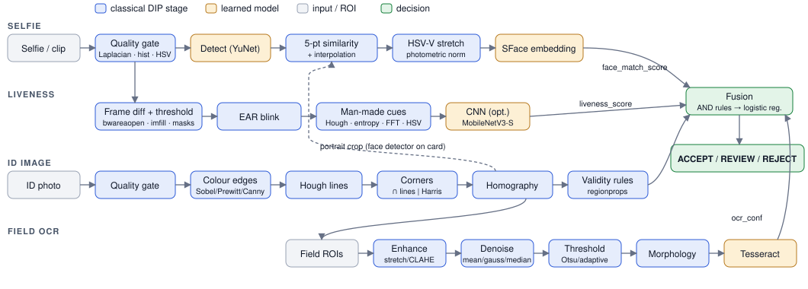

# eKYC identity verification with classical DIP stages

DIP course project (RGIPT, B.Tech IT, 2026), topic **HSR-AIML-029: Multimodal eKYC identity verification with face, document and liveness signals.**

Given a selfie (optionally a short selfie clip) and a photo of an ID card, the system decides **ACCEPT / REVIEW / REJECT**. It answers three questions: is the card a real card, is the selfie the person on the card, and is the selfie a live person rather than a print or a screen.

**Thesis.** Classical DIP stages from the lab course measurably improve verification under real capture conditions (glare, blur, perspective, low light, print and compression artefacts), and learned models improve further on top of them. Every module therefore has a baseline built from lab operations, an improved variant, and ablations that isolate each stage.

<!-- RESULTS:START -->
## Headline results

_Generated by `scripts/summarize_results.py` from `results/*.csv` (commit `uncommitted`)._

**Face verification** (EER with 95% bootstrap CI; lower is better)

| Dataset | Baseline: Haar + landmark distances | Improved: YuNet + align + HSV-V + SFace | TAR@FAR=1e-2 (improved) |
|---|---|---|---|
| lfw | 45.5% [42.7%, 48.6%] | **1.0%** [0.5%, 1.7%] | 99.2% |
| synthetic_doc | 43.7% [39.6%, 47.8%] | **3.0%** [1.8%, 5.0%] | 95.0% |

**Document** (synthetic captured cards)

| Source | Variant | Quad IoU | IoU > 0.9 | Corner error (px) | Field CER | Exact fields |
|---|---|---|---|---|---|---|
| synthetic | baseline | 0.671 | 6.0% | 146.5 | 91.6% | 6.6% |
| synthetic | improved | 0.972 | 92.2% | 9.0 | 14.3% | 81.4% |

**E12: where the face gain comes from** (EER)

| Variant | LFW | Synthetic doc-vs-selfie |
|---|---|---|
| haar + geometric (baseline) | 45.5% | 43.7% |
| yunet + geometric | 46.0% | 43.0% |
| sface, no align, no enh | 6.5% | 11.3% |
| sface + align | 1.0% | 3.7% |
| sface + align + CLAHE-V | 1.8% | 5.0% |
| sface + align + stretch-V, no descreen | 1.0% | 6.0% |
| sface + align + stretch-V + descreen (default) | 1.0% | 3.0% |

**Ablations**

- **E1 bit depth:** EER 8 bit 1.0%, 6 bit 1.0%, 4 bit 1.2%, 3 bit 1.3%, 2 bit 6.8%, 1 bit 30.8%.
- **E2 interpolation at 1/8 resolution:** nearest 21.7%, bilinear 7.7%, bicubic 6.3%, lanczos 6.8%.
- **E3 JPEG:** EER q95 1.0%, q75 0.8%, q50 1.0%, q30 1.2%, q10 1.5%; OCR CER q95 4.2%, q75 4.4%, q50 4.5%, q30 4.5%, q10 5.0%.
- **E4 low-light enhancement:** OCR CER none 8.5%, stretch 8.5%, gamma 4.3%, histeq 124.8%, clahe 26.1%; face EER none 1.8%, stretch 1.5%, gamma 1.5%, histeq 1.8%, clahe 1.8%.
- **E5 colour:** hue shift rgb 49.0°, hsv_v 0.6°; EER rgb 1.5%, hsv_v 1.2%.
- **E6 edge operator:** quad IoU canny 0.971, prewitt 0.953, sobel 0.955.
- **E7 corners:** mean corner error contour 40.8 px, harris 49.8 px, hough 9.5 px.
- **E8 denoising (CER):** gaussian: none 4.4%, mean 5.3%, gaussian 4.3%, median 5.7%; salt_pepper: none 57.4%, mean 7.9%, gaussian 11.1%, median 6.2%.
- **E9 thresholding (CER):** clean: otsu 4.9%, adaptive_mean 56.3%, adaptive_gaussian 34.3%; uneven light: otsu 59.7%, adaptive_mean 37.6%, adaptive_gaussian 19.3%.
- **E13 quality gate:** gate off: FRR 25.3%, CER 50.0%, retake 0.0%; gate on: FRR 6.8%, CER 14.3%, retake 52.7%.
- **E14 fusion:** fixed AND thresholds: FAR 1.1%, FRR 15.6%; logistic regression @ accept: FAR 0.0%, FRR 10.0%; logistic regression @ fixed-rule FAR: FAR 1.1%, FRR 4.4%. _NO liveness data: liveness fixed at 1, fusion covers face + document + quality only_
- **E10:** pending own-capture liveness clips (`data/own_capture/`).
- **E11:** pending own-capture liveness clips (`data/own_capture/`).

<!-- RESULTS:END -->

## Architecture



```
src/ekyc/            Python package: pure image-processing stages, evaluation, API, CLI
  quality.py         blur (var. of Laplacian), exposure (histogram), glare (HSV slicing + cleanup)
  enhance.py         stretch, log, gamma, histeq (from scratch), CLAHE; grey / per-RGB / HSV-V modes
  filters.py         mean, Gaussian, median, mode, Laplacian, LoG, unsharp
  degrade.py         seeded degradations: bit depth, resolution, JPEG, blur, noise, glare, halftone, perspective, low light
  metrics.py         ROC/AUC/EER/TAR@FAR, APCER/BPCER/ACER, CER/WER, quad IoU, corner error, bootstrap CI
  document/          colour edges -> Hough corners -> homography -> validity rules -> portrait -> field OCR chain
  face/              Haar | YuNet detection, MediaPipe mesh, 5-point alignment, landmark-distance baseline, SFace embedding
  liveness/          frame-difference motion, EAR blink, man-made cue features, MobileNetV3 CNN (optional)
  fusion.py          fixed AND thresholds vs logistic regression -> ACCEPT / REVIEW / REJECT
  pipeline.py        verify(): timed stages sharing one Debug sink of intermediate images
  eval/              dataset indexes, per-module evaluation, ablations E1-E14
  api.py             FastAPI backend (stateless; images returned as data URLs)
  cli.py             `ekyc` command
web/                 React + TypeScript + Vite frontend (no UI library)
configs/default.yaml every threshold, kernel size, path and model URL
scripts/             dataset download / preparation
tests/               metrics, determinism, geometry, enhancement, API smoke tests
report/              block diagram and report figures
```

**Backend.** `ekyc serve` starts FastAPI on one process. The API is a thin layer over the same pure functions the CLI and experiments use; it holds no DIP logic and no per-request state.

| Endpoint | Purpose |
|---|---|
| `POST /api/verify` | `selfie`, `id_image`, optional `video` (multipart) → decision, module scores, OCR fields, quality reasons, per-stage timings and every intermediate image |
| `POST /api/lab` | `image`, `op`, `params` (JSON) → output image, before/after histograms, measurements, intermediate images. Ops: `enhance`, `filter`, `edges`, `threshold`, `morphology`, `degrade`, `quality`, `hough`, `document`, `face` |
| `GET /api/experiments` | E1–E14 and the headline tables, read live from `results/*.csv`, plus figure URLs |
| `GET /api/samples` | genuine and impostor synthetic pairs for one-click demos |
| `GET /api/health`, `GET /api/config` | model and Tesseract availability, active config |

Uploads are size-limited (15 MB images, 80 MB clips) and validated. Clip temp files are deleted after decoding. A global lock serialises inference because the MediaPipe and OpenCV DNN objects are shared.

**Frontend** (`web/`), four pages:

- **Verify**: upload or webcam (photo + 4 s clip), or pick a sample pair. Shows the decision banner, face/liveness/document/quality cards, OCR table, stage runtimes and a gallery of every intermediate image by stage.
- **DIP Lab**: apply any course operation to your own image with live sliders. Shows before/after histograms, measurements, and the MATLAB equivalent of each operation.
- **Experiments**: tables and figures for every experiment, with the command to run the missing ones.
- **Pipeline**: block diagram plus the course-concept → code → MATLAB map.

## Setup

Requirements: Python 3.11, [uv](https://docs.astral.sh/uv/) (or pip), the Tesseract binary, and Node 20+ to build the UI.

```bash
brew install tesseract
uv sync --extra dev
source .venv/bin/activate
ekyc models
```

- On Ubuntu, install Tesseract with `sudo apt install tesseract-ocr`.
- `uv sync` installs the exact versions in `uv.lock`. Add `--extra cnn` for the liveness CNN (torch); plain `uv sync --extra dev` uninstalls it.
- `ekyc models` downloads YuNet, SFace, the MediaPipe face landmarker and the Haar cascade into `models/`.
- Instead of activating the venv you can prefix commands with `uv run`.

Without uv: `python3.11 -m venv .venv && . .venv/bin/activate && pip install -e ".[dev]"`.

## Data

Nothing under `data/` is committed.

| Data | Command | Notes |
|---|---|---|
| **LFW** (face verification) | `python scripts/download_lfw.py` | ~230 MB via scikit-learn's downloader. The official 10-fold `pairs.txt` protocol is used; ablations take a balanced subset spread over all folds (`eval.lfw_pairs`). Huang et al., UMass TR 07-49, 2007. |
| **Synthetic doc-vs-selfie pairs** | `python scripts/make_degraded_pairs.py` | 600 pairs, ~220 MB, seeded. LFW face A is printed into a mock ID-1 card (guilloche background, fake name/date/number fields), halftoned, placed on a textured desk under a random homography, then given glare, low light, blur and JPEG. The portrait is cropped back via the ground-truth quad and paired with LFW face B. `manifest.csv` records the GT quad, field values/rects and every degradation parameter. This is also the always-available document benchmark. |
| **MIDV-2020** (real mock IDs) | `python scripts/download_midv2020.py` | Templates + photos, 4.9 GB, MD5-verified, from `ftp://smartengines.com/midv-2020`. CC BY-SA 2.5. VIA annotations: field rects + values in `templates/`, `doc_quad` in `photo/`. The document eval and E6/E7 pick it up automatically. Bulatov et al., *Computer Optics* 46(2), 2022, arXiv:2107.00396. |
| **Own liveness capture** | record, then `python scripts/prepare_liveness.py` | `data/own_capture/<subject_id>/{live,print,replay}/*.mp4`, 5–10 s each, varied lighting, ≥10 consented subjects, anonymised IDs. Splits are subject-disjoint. Recordings are deleted after grading per the consent form. |

## Run

Every code block below is plain commands with no inline comments, so it pastes cleanly into zsh (which does not treat `#` as a comment interactively).

Start the web app (UI + API on http://127.0.0.1:8000):

```bash
cd web && npm install && npm run build && cd ..
ekyc serve
```

Verify one pair from the command line (prints JSON and writes every intermediate image to `out/`; add `--video clip.mp4` for motion + blink liveness):

```bash
ekyc verify --selfie me.jpg --id card.jpg --debug-dir out/
```

Tests and evaluation:

```bash
pytest
ekyc eval face
ekyc eval document
ekyc eval fusion
ekyc ablate --exp E1 E6
python scripts/summarize_results.py
```

| Command | What it does |
|---|---|
| `pytest` | 30 tests: metrics against known values and sklearn, degradation determinism, geometry, API smoke |
| `ekyc eval face` | baseline vs improved on LFW + synthetic pairs → `results/face_summary.csv`, ROC and intermediates figures, val-tuned thresholds |
| `ekyc eval document` | quad IoU, corner error, field CER on synthetic cards (and MIDV-2020 if downloaded) |
| `ekyc eval liveness` | needs own-capture clips; trains `models/liveness_lr.joblib` |
| `ekyc eval fusion` | needs face + document results; trains `models/fusion_lr.joblib` |
| `ekyc ablate --exp E1 E6` | run chosen experiments; `--all` runs E1–E14 plus the FAILURES galleries |
| `python scripts/summarize_results.py` | regenerate the headline-results block at the top of this README |

UI development: run `ekyc serve --reload` and `cd web && npm run dev`, then open http://localhost:5173. Vite proxies `/api` and `/results` to the backend.

## Experiments

Each experiment writes `results/<id>.csv` (with the git commit hash) and `results/figures/<id>*.png`. Face experiments degrade only the document side of each pair, because the ID portrait is the degraded capture in deployment. OCR experiments rectify with the ground-truth quad so only the studied stage varies. Thresholds are tuned on synthetic folds 0–6 and never on test folds 7–9.

| ID | Question | Data |
|---|---|---|
| E1 | Face EER vs bit depth (8→1) | LFW |
| E2 | Face EER vs resolution × interpolation kernel | LFW |
| E3 | Face EER and OCR CER vs JPEG quality | LFW, synthetic cards |
| E4 | Enhancement (none/stretch/gamma/histeq/CLAHE) under low light: EER and CER | LFW, synthetic cards |
| E5 | Per-RGB vs HSV-V equalisation: hue shift and EER | LFW |
| E6 | Sobel vs Prewitt vs Canny for card localisation (quad IoU) | synthetic (+MIDV) |
| E7 | Hough intersections vs contour vs contour+Harris (corner error), with accumulator figure | synthetic (+MIDV) |
| E8 | Mean vs Gaussian vs median filter under Gaussian and salt-and-pepper noise (CER) | synthetic cards |
| E9 | Otsu vs adaptive mean/Gaussian threshold, clean and uneven light (CER) | synthetic cards |
| E10 | Motion liveness vs frame-difference threshold (APCER/BPCER) | own capture |
| E11 | Motion vs blink vs man-made cues (rules/LR/SVM) vs CNN vs fused (ACER) | own capture |
| E12 | Face headline: geometric baseline → +YuNet → SFace → +alignment → +CLAHE-V | LFW, synthetic |
| E13 | Pipeline with vs without quality gate: FRR and CER when half the captures are degraded | synthetic |
| E14 | Fusion: fixed AND thresholds vs logistic regression (ROC) | synthetic (+own capture) |

## Design notes

- **Colour edges.** On synthetic captures, a grey header bar on a red desk had nearly equal grey levels, so the card edge vanished after RGB→grey conversion. OR-ing per-channel edge maps fixed it: on that sample, corner error fell from 31 px to 3 px. This is a config switch (`document.color_edges`) you can ablate.
- **Outermost-line rule in Hough.** Inner header bars and text rows produce long horizontal lines too, so each side takes the outermost line among the long ones in its cluster.
- **Hough proposes, the region verifies.** Hough sides are the outermost line ≥ 0.4× the longest in each cluster, refit by least squares on edge pixels within 3 px; a valid region blob vetoes Hough quads it disagrees with. Tuned on every third card: IoU > 0.9 went 65% → 92%. E7 shows contour corners alone are precise when right but fail badly, and Harris snapping makes it worse (it locks onto glyph and portrait corners).
- **Descreening.** Every face false reject in the failure gallery was a halftoned print that YuNet missed. A Gaussian low-pass retry (σ = 1.5) on detection failure recovered 17/17 and broke none of 150 working portraits.
- **Photometric normalisation chosen on validation.** CLAHE on the HSV V channel *hurt* SFace (val EER 7.1% vs 5.7%): a learned embedding expects natural image statistics. HSV-V contrast stretch ties on normal exposure and helps in low light (E4), so it is the default. Alignment is the big DIP win (E12).
- **SFace instead of insightface ArcFace.** SFace is a margin-based CNN embedding from the ArcFace family that runs through OpenCV DNN. It needs no onnxruntime and avoids a 280 MB model pack.
- **Glare = clipped highlights.** V > 250 and S < 40, measured inside the face box or card quad only. A cutoff of 230 fired on pale card stock and white shirts.
- **OpenCV 5 / MediaPipe ≥ 1.0.** Haar XMLs are no longer bundled, so `ekyc models` downloads them. MediaPipe's legacy `solutions` API is gone; the Tasks `FaceLandmarker` is used.

## Limitations

- Liveness has code and evaluation but no data yet. E10, E11 and the liveness part of E14 run once own-capture clips exist; until then the web demo uses the single-frame man-made-cue rules.
- The synthetic cards are cleaner than real IDs: Tesseract reads clean, rectified fields almost perfectly, so the OCR ablations rely on added noise and uneven light. MIDV-2020 is the realistic test.
- Fusion has no joint dataset; attempts are assembled assuming independent modules (stated in the E14 output).
- The card-validity rules pass only ~70% of genuine synthetic cards. Most rejections come from region segmentation (the filled blob is a fragment) and a perimeter²/area bound that is tight for jagged blob outlines. The bounds should be re-tuned on validation cards; the Hough veto would then need re-checking.

## Team

- Student A: quality gate, document module.
- Student B: face, liveness.
- Shared: degradation, metrics, fusion, web UI, report.

_Names and roll numbers: TBD._
